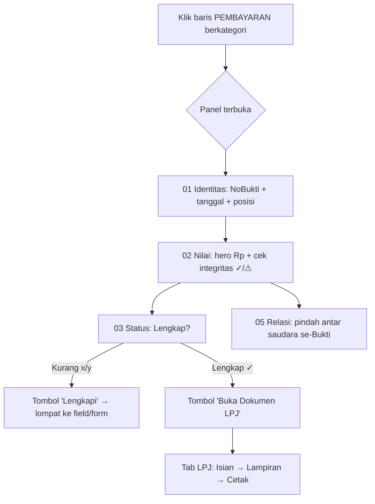

# Riset: Tampilan Detail Transaksi Premium (Sidebar BKU)

> Tanggal: 2026-11-26 · Status: KONSEP (belum coding) · Skill: `ux-user-flow` + `wireframe-spec` · Figma MCP: bridge OFFLINE, REST token OK — materialisasi visual menunggu URL file / bridge dibuka user.
> Perintah asal: "research mendalam terkait tampilan detail transaksi, berikan konsep premium nya menggunakan skill dan mcp figma terlebih dahulu".

---

## 1. Anatomi Saat Ini (audit kode, bukan asumsi)

### 1.1 Dua wajah panel

| Aspek | Tab Detail (non-LPJ) | Tab Dokumen LPJ |
|---|---|---|
| Lebar | Sempit `max-w-xl`, sudut `rounded-l-3xl` | Full-bleed `left-0 max-w-none` |
| File | `BKUSidebar.jsx` L208–532 | `BKUSidebarLpj.jsx` + `BKUSidebarLpjToolbar.jsx` + `SidebarPbj.jsx` + `BKUSidebarDokumentasi.jsx` |
| Isi | Nilai hero + Rincian + Kategori + Anggota + ATK | Toolbar sticky + form LPJ + blok PBJ + dokumentasi + preview + cetak |
| Jump bar bawah | Rincian / Anggota + Tutup | Isian / Lampiran / Cetak + Tutup |

### 1.2 Struktur seksi Detail (dengan nomor bermasalah)

1. **Sticky header** — tutup · dot kategori · NoBukti (mono) · tanggal/baris · prev/next + counter. (`BKUSidebar.jsx` L224–277)
2. **`02` Nilai Transaksi** — badge tipe + pill kategori + NoBukti kanan; hero `Rp 30px`; uraian; nama kegiatan; strip Debet/Kredit/Saldo 3-kolom; tombol Coretax ganda khusus setor pajak. (L284–349)
3. **`04` Rincian Transaksi** — `dl` grid 2-kolom: NoBukti, Tanggal, Kegiatan (full), Rekening (full + nama resolved). (L351–387)
4. **Kategori Belanja — TANPA nomor** — 3 varian: operasional info-only, kategori terpetakan, belum-dipetakan. (L395–422)
5. **Anggota se-Bukti — TANPA nomor** — list baris se-NoBukti + pill kategori mini per baris. (L424–458)
6. **Kelompok ATK — TANPA nomor** — toggle SIPLAH / Non-SIPLAH. (L459–468)
7. **Sticky bottom bar** — pill kategori + tombol lompat + Tutup gelap. (L497–529)

### 1.3 Temuan audit (7 cacat yang menghambat kesan premium)

| # | Cacat | Lokasi | Dampak |
|---|---|---|---|
| F-1 | **Penomoran fiktif**: `02` lalu `04`, tanpa `01`/`03`; seksi berikutnya tanpa nomor | `BKUSidebar.jsx` L285, L352, L396, L426, L460 | Janji urutan yang tidak ditepati → terasa setengah jadi |
| F-2 | **Status dokumen tak terlihat**: readiness LPJ hanya pill kecil di toolbar LPJ; tab Detail tak tahu dokumennya lengkap atau tidak | `BKUSidebarLpjToolbar.jsx` L55–56; Detail: tidak ada | User tak tahu "kurang apa" tanpa membuka tab lain |
| F-3 | **Dua tombol Coretax berdampingan** (link bayar + label jenis pajak non-aksi, gaya tombol) | L330–347 | Affordance palsu: satu terlihat bisa diklik padahal label |
| F-4 | **Anggota se-Bukti datar**: list tanpa total per baris yang menonjol, tanpa indikasi baris aktif selain garis 1.5px | L431–457 | Sulit scan "baris ini vs saudaranya" |
| F-5 | **Jump bar ≠ seksi**: label lompat (Rincian/Anggota) tak mencerminkan semua seksi; seksi tanpa `id` tak bisa dituju | L506–519 vs L396, L460 | Navigasi dalam panel tidak jujur |
| F-6 | **Kebenaran angka tak terbukti**: Debet/Kredit/Saldo ditampilkan, tapi tak ada cek "saldo = saldo lalu + debet − kredit" | L316–329 | Panel kaya data tapi miskin kepercayaan |
| F-7 | **Aksesibilitas**: tombol icon tutup/prev/next tanpa `aria-label` eksplisit (prev/next hanya `title`); readiness pill bukan `aria-live` | L226–274, toolbar L55 | Gagal aturan Web Interface Guidelines (focus + live region) |

---

## 2. Konsep Premium: "Dossier Bernomor" (rekomendasi ★)

Evolusi — bukan revolusi. Pertahankan yang sudah benar (sticky header, hero nominal, bottom jump bar, portal ke body, kertas putih), perbaiki yang fiktif.

### 2.1 Information Architecture (final, bernomor jujur)

```
01 IDENTITAS  (sticky header — sudah ada, tinggal poles)
02 NILAI      (hero nominal + strip integritas Debet/Kredit/Saldo + cek ✓)
03 STATUS     (BARU — kartu status dokumen: Lengkap/Kurang ×/y + tombol aksi)
04 RINCIAN    (grid field — sudah ada, tambah salin-1-klik)
05 RELASI     (gabungan Anggota se-Bukti + Kelompok ATK — satu seksi)
06 AKSI       (deep-link: Buka Dokumen LPJ / Bayar Coretax / Tutup)
```

- Setiap seksi punya `id` jangkar; **jump bar bawah = cermin 1:1** (Nilai · Status · Rincian · Relasi). F-1 & F-5 mati.
- Tab LPJ memakai nomor yang sama: toolbar = 01+03 (identitas + status), form = perpanjangan 04, blok PBJ = Lampiran (05), preview + cetak = 06. Satu bahasa di dua wajah.

### 2.2 User flows inti (Mermaid)



Error/edge states: tanpa NoBukti → Simpan mati + hint (sudah ada, pertahankan); baris non-pembayaran → klik mati (sudah ada); tak berkategori → toast pemandu (sudah ada); **baru: cek integritas gagal → strip kuning "Selisih Rp x — periksa baris"** (F-6).

### 2.3 View specification — zona per zona

| Zona | Premium touch | Aturan tetap |
|---|---|---|
| 01 Header sticky | NoBukti mono 13px + sub "tanggal · baris i/n"; prev/next 32px; progress "i/n" tabular | Blue-only, tanpa blur berat |
| 02 Hero | `Rp` 30px semibold-tight; di bawahnya **strip integritas**: 3 angka + ikon ✓ hijau-muted / ⚠ kuning **hanya saat selisih** (satu-satunya warna non-biru yang diizinkan = status sementara) | Hero angka = satu-satunya 30px di panel (hierarki F-pattern) |
| 03 Status (BARU) | Kartu: ring progress `x/y field` + daftar kurang (maks 3, "+n lagi") + 1 CTA primer ("Lengkapi"/"Buka Dokumen"); `aria-live="polite"` | Gaya kartu = `rounded-2xl bg-slate-50`, bukan warna blok |
| 04 Rincian | Field label 10px uppercase; nilai 14px semibold; **ikon salin** muncul saat hover per field (NoBukti, kode) | `dl` semantik dipertahankan |
| 05 Relasi | Baris saudara: uraian + nominal kanan tabular; baris aktif = wash `bg-primary/5` + label "saat ini"; total grup di footer seksi | Satu seksi, satu total |
| 06 Aksi | Primer: "Buka Dokumen LPJ" (LPJ) / "Bayar via Coretax" (setor); sekunder: Tutup. **Jenis pajak = teks meta, bukan tombol** (F-3) | Primer selalu `bg-slate-900` / `bg-primary` |
| Jump bar | Pill kategori kiri + 4 lompat + Tutup; tombol aktif saat seksinya terlihat (IntersectionObserver, murah) | Sticky bottom, blur ringan |

### 2.4 Alternatif yang ditolak (dicatat agar tak diulang)

- **B: Tab "Ringkasan / Uang / Dokumen"** — menghidupkan kembali tab yang user matikan 2026-10-21. Ditolak.
- **C: Timeline vertikal penuh** — cantik untuk audit trail, tapi 90% baris hanya butuh "berapa + dokumen apa". Disimpan untuk mode Audit masa depan.

### 2.5 Motion & aksesibilitas (batas tegas)

- Motion: `slide-in-left` 200ms + lompat smooth (sudah ada) + **skeleton shimmer saat ganti baris** (maks 150ms, menutup kedip prefill). Tanpa parallax, tanpa animasi angka.
- A11y (Web Interface Guidelines): `aria-label` di semua tombol ikon (F-7); readiness = `aria-live`; fokus terlihat `focus-visible:ring`; heading `h3` per seksi; kontras slate ≥ 4.5:1; target sentuh ≥ 40px di jump bar.

---

## 3. Rencana Figma (menunggu: URL file ATAU bridge dibuka)

### 3.1 Token (collection `SPJ / Core`, mode Light + Dark)

`primary #004AC6 · ink #0F172A · paper #FFFFFF · wash #F1F5F9 · line #E2E8F0 · radius 12/16/24 · spacing basis 4 · type: Inter/system, hero 30/B, judul 13/SB, label 10/UC` + mode Dark (`paper #0F172A`, wash transparan).

### 3.2 Komponen (page `Dossier Detail`, section per varian)

`Panel/Detail-600` · `Panel/LPJ-Full` · `01-Header` · `02-HeroNilai` (+varian `selisih`) · `03-StatusCard` (Lengkap/Kurang) · `04-FieldRow` (+hover salin) · `05-RelasiRow` (aktif/saudara) · `06-AksiBar` · `JumpBar` · `Toolbar-LPJ` · `Skeleton-Baris`. Setiap komponen: anotasi F-1…F-7 yang diperbaikinya.

### 3.3 Langkah materialisasi (setelah user merespons)

1. User kirim URL file Figma **atau** buka Figma Desktop → Plugins → Development → Figma Desktop Bridge → Run.
2. Saya gambar `Panel/Detail-600` + `03-StatusCard` dulu (risiko tertinggi), screenshot, iterasi maks 3×.
3. Lanjut `Panel/LPJ-Full` + `JumpBar`; ekspor token → `index.css` variables; tulis handoff ke kode (peta §4).

---

## 4. Peta implementasi kode (nanti, setelah konsep disetujui)

| Konsep | File sentuh | Perubahan |
|---|---|---|
| Nomor jujur 01–06 + `id` jangkar | `BKUSidebar.jsx` | `Seksi no=` dilengkapi; Kategori→04, Anggota+ATK→05 Relasi; jump bar 4 tombol + observer aktif |
| 03 StatusCard | `BKUSidebar.jsx` (baru, ~60 baris) | Baca `readinessSidebar`/`cekKelengkapan` yang sudah ada; tanpa logika baru |
| Strip integritas | `BKUSidebar.jsx` L316–329 | Hitung `saldoLalu + debet − kredit ≈ saldo`; selisih → badge kuning |
| Coretax jujur | `BKUSidebar.jsx` L330–347 | Jenis pajak jadi teks meta + 1 tombol primer |
| Salin-1-klik | `BKUSidebar.jsx` L354–386 | Tombol salin hover + `navigator.clipboard` + toast |
| A11y | `BKUSidebar.jsx`, `BKUSidebarLpjToolbar.jsx` | `aria-label` prev/next, `aria-live` status, `focus-visible:ring` |

Gate tetap: `npm run build` exit 0 · `vitest` 116/116 · screenshot browser light+dark · tanpa commit/push.

---

## 5. Pertanyaan untuk user (jawab 1–2 saja)

1. **Figma**: kirim URL file, atau buka Desktop Bridge agar saya menggambar langsung?
2. **03 StatusCard**: setuju jadi seksi baru (butuh baca readiness yang sudah ada), atau cukup pill seperti sekarang?
3. **Arah visual**: Dossier bernomor (★ rekomendasi) atau Timeline audit (C)?
