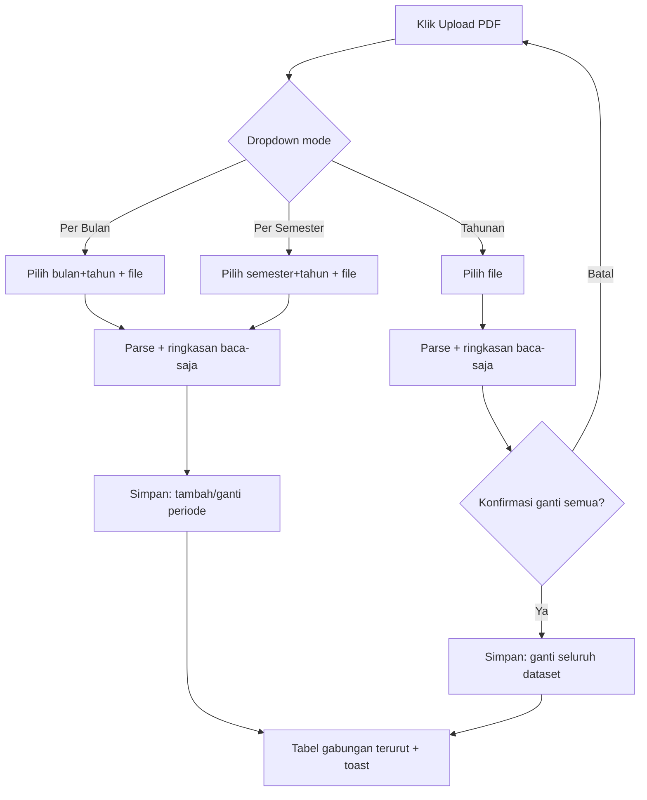

# User Flow & UX Specifications: Upload BKU PDF 3 Mode

- Sumber: `docs/prd-bku-upload-mode.md` (US-1 s/d US-5, FR-1 s/d FR-9)
- Lokasi layar: halaman BKU (`BKUPage.jsx` + `BKUUploadPdf.jsx`)
- Prinsip: perilaku + struktur milik builder; visual final milik tim UI (BLUE-ONLY `#004ac6` + slate tetap mengikat)

## 1. Information Architecture

- Halaman BKU (existing, tidak berubah struktur):
  - Hero upload Excel (jalur lama, tidak disentuh)
  - Tombol **Upload PDF** → sekarang membuka **dropdown 3 mode** (baru)
    - `BKU Per Bulan` → pemilih Bulan + Tahun → file picker PDF
    - `BKU Per Semester` → pemilih Semester + Tahun → file picker PDF
    - `BKU Tahunan` → file picker PDF (tahun ikut kop PDF)
  - Panel hasil: ringkasan per periode + tabel data gabungan terurut tanggal (existing, tambah penanda periode)
- State simpan: `spj_bku_data` (localStorage, kunci tidak berubah); tiap baris bawa `periodeMode` + `periode`.

## 2. Core User Flows

### F-1 Upload Bulanan (US-1, US-2)
1. Empty/Populated → klik Upload PDF → dropdown → pilih Per Bulan → pilih bulan+tahun → pilih file → parse otomatis.
2. Sukses → toast: "N baris bulan X disimpan (tambah/ganti)" → tabel gabungan terurut ulang, bulan lain utuh.
3. Upload ulang bulan sama → dialog-less replace: data bulan itu diganti, toast "Maret diganti (N baris)".
4. File identik (hash sama) → toast info "sudah ada, dilewati" (tanpa duplikat).

### F-2 Upload Semester (US-3)
Sama seperti F-1 dengan granularitas semester; gabungan bulan+semester tetap satu tabel kronologis.

### F-3 Upload Tahunan (US-4)
1. Klik Upload PDF → Tahunan → pilih file → parse → **konfirmasi eksplisit** ("Ganti SELURUH data dengan PDF tahunan? Akumulasi bulanan akan hilang.") → Ya → seluruh dataset diganti.
2. Konfirmasi ini satu-satunya dialog baru; untuk mode akumulasi tidak ada dialog (langsung simpan).

### F-4 Tanpa koreksi (US-5)
Tidak ada layar preview-edit / form koreksi / kecualikan baris. Ringkasan baca-saja (N baris · periode · balance ya/tidak) tampil sebagai konfirmasi sebelum tombol Simpan ditekan.

### Error states & recovery
- File bukan PDF → tolak + pesan (perilaku existing dipertahankan).
- Parse gagal / 0 baris → pesan jelas, dataset lama utuh.
- Bulan di kop PDF ≠ bulan dipilih → peringatan + pilihan "lanjutkan" / "batal".
- Kuota localStorage penuh → gagal simpan + pesan, data lama tidak rusak.

## 3. View Specifications

- Dropdown mode: menempel pada tombol Upload PDF existing (posisi & gaya ikut kanon tombol premium yang ada).
- Pemilih periode kontekstual: Bulan+Tahun (12 opsi + tahun), Semester (Ganjil/Genap + tahun), muncul sesuai mode.
- Ringkasan pra-simpan (baca-saja): nama file, periode terbaca dari kop, N baris, total penerimaan/pengeluaran/saldo, status balance.
- Tabel gabungan: tambah penanda periode per kelompok baris (mis. seksi/subheader per bulan) — visual oleh tim UI.
- States: Empty (belum ada data) / Loading parsing (progress existing) / Populated / Error (lihat F-error).

## 4. Interaction Patterns

- Semua aksi simpan bersifat langsung tanpa draft; satu-satunya konfirmasi adalah mode Tahunan.
- Toast sukses mengikuti pola existing: "N baris dari periode X disimpan (tambah/ganti). Balance ya/tidak."
- Upload ulang file identik tidak menambah duplikat (cek hash).

## 5. Design System Integration

- Pakai tombol, toast, panel, dan kanon upload premium yang sudah ada di halaman BKU.
- Warna mengikat: BLUE-ONLY `#004ac6` + slate (CONSTITUTION).
- Dropdown + pemilih periode memakai komponen form existing; tidak ada komponen baru kecuali perlu.

## 6. Accessibility Considerations

- Dropdown & pemilih periode dapat dioperasikan keyboard penuh (Tab/Enter/Escape menutup).
- Pesan error/toast terbaca screen reader (aria-live mengikuti pola Toast existing).
- Target sentuh ≥ 44px untuk tombol Upload PDF & opsi dropdown.

## 7. Technical Implementation Notes

- Komponen: `BKUPage.jsx` (tombol + dropdown + state mode), `BKUUploadPdf.jsx` (pintu PDF; **hapus** form koreksi inline/exclude, pertahankan tulis atomik per aksi).
- Parser: `bkuParser.js` + `bkuPdf*.js` tidak berubah format baca; tambah penanda tipe baris (TRANSAKSI / SALDO_AWAL / JUMLAH / BUNGA_NOL) + metadata periode per baris.
- Util baru (di `utils/`): gabung dataset per periode (`mergePeriode`), urut kronologis, hash file, validasi saldo-vs-PDF.
- Tulis storage atomik per aksi (pola existing `storageHelper.set` satu kali); tanpa library baru (tetap pdf.js).
- Bukti acceptance: skrip cek per-baris vs kolom Saldo PDF + total vs baris Jumlah untuk `bku-output-maret.pdf` dan `bku-output-april.pdf`.

## 8. v0.dev / Mockup Prompt

> Dashboard form "Upload BKU PDF" for Indonesian school admin app, blue-only (#004ac6) + slate palette.
> One Upload PDF button opening a dropdown with 3 options (Per Bulan / Per Semester / Tahunan);
> contextual period picker (month+year / semester+year) appearing per mode; read-only summary card
> (file name, period, row count, totals, balanced status) with a single Save button; no edit forms.
> Result table grouped by month subheaders, chronological. Premium minimal style, A4 print unaffected.
